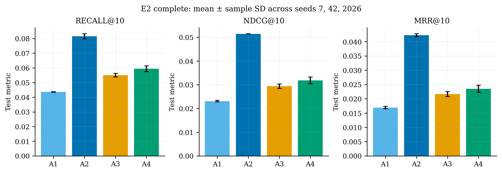
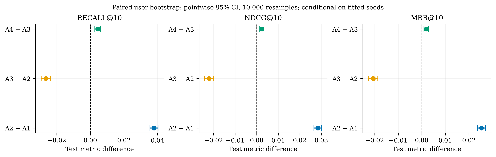
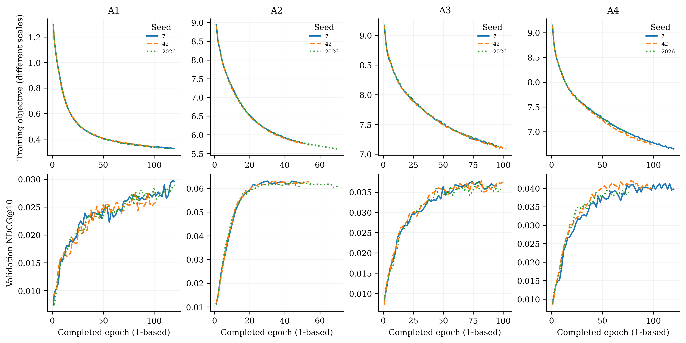
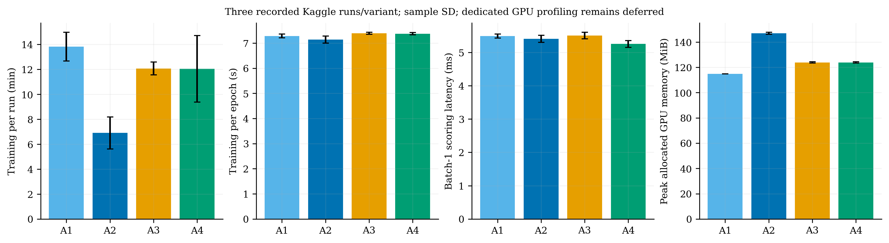

# Báo cáo thực nghiệm cuối cùng — Đồ án Data Mining

Ngày chốt: **27/11/2026**. **Phạm vi thực nghiệm môn học đã đóng; không còn training, tuning hoặc GPU profiling được yêu cầu.** Đây là hoàn thành phạm vi môn học, không phải hoàn thành grid nghiên cứu gốc.

## 1. Trạng thái cuối cùng và nguồn bằng chứng

| Thành phần | Trạng thái | Số run đã hoàn thành |
|---|---|---|
| Hyperparameter Tuning | COMPLETE | 15 |
| E1 | COMPLETE | 16 |
| E2 | COMPLETE | 12 |
| E3 | DEFERRED | 0 |
| E4 | DEFERRED | 0 |
| E5 | DEFERRED | 0 |
| TIGER | THEORY_ONLY | N/A |
| CRAMER | THEORY_ONLY | N/A |
| E7 recorded analysis | COMPLETE | N/A |
| E7 dedicated profiling | DEFERRED | 0 |
| E8 | COMPLETE | N/A |

Grid gốc chỉ được giữ làm tham khảo: **28/127**, còn 99 jobs không thuộc phạm vi môn học đã chốt. E3/E4/E5 hoãn vì tài nguyên và phạm vi môn học; không chọn phạm vi theo test score. Không biến E3 retention 1.0 có thể reuse thành E3 SUCCESS khi chưa tạo artifact tương ứng. TIGER và CRAMER chỉ nghiên cứu lý thuyết, không có kết quả thực nghiệm của đồ án.

Nguồn mới: `seqrec-e2-final-20261127_122610_032968.zip`, SHA256 `4bc3da79817ad1463f1c4ff16b2e9aa13efbad8e9caad20f9368cfb690acdc39`. Archive có **354 tệp**, gồm **28 SUCCESS**, **55 checkpoint** (28 best + 27 latest) và **306 artifacts có hash trong status**. Đã xác minh config fingerprints, weights/resume state, split, tất cả predictions/metrics; rehash dataset Beauty theo manifest lưu trong archive và kiểm tra chronology.

Đối chiếu **262 tệp của 22 run cũ** với ZIP phiên trước: **0 thay đổi**, kể cả checkpoint, predictions, metrics, config và log. Phase 5C được kiểm tra lại hash ZIP và toàn bộ **182 raw files**; năm selections trong master plan khớp chính xác các cấu hình validation đã chốt. Không trộn validation tuning với final test scores.

ZIP mới được giữ tại `artifacts/e2_final/`; bản gốc ngoài repository vẫn giữ nguyên. Import tái sử dụng **289 tệp nội dung trùng** với phiên trước bằng hard link khi cùng filesystem, khoảng **385.3 MiB logical bytes**, thay vì giải nén lại toàn bộ. Các tệp raw được xem là immutable; không sửa tại chỗ vì hard links chia sẻ bytes. Nếu filesystem không hỗ trợ hard link, importer mới copy riêng các tệp cần thiết. Release mới chỉ đóng gói sáu run E2 bổ sung, không repack 22 run cũ.

## 2. Phương pháp và nguyên tắc thống kê

Beauty có 22.363 users, 12.101 items, 198.502 interactions; train 153.776 events, validation/test mỗi tập một target/user. Test history là train + validation; không đưa target test vào encoder. Full catalogue, seen-history mask, target exception, PAD/MASK exclusion và item-ID tie ordering được giữ nguyên. Tất cả 22.363 test users được giữ; warm cohort có 22.225 users. Split SHA: `2228499f23f01d419863d0f09b3671f098672471887c4fb37b85bae26d42f91e`.

Checkpoint chọn bằng validation NDCG@10, không chọn bằng test. Neural E1 và mỗi E2 variant có ba seeds 7/42/2026. Báo cáo mean và **sample SD, ddof=1**; MostPopular là predictor xác định chỉ chạy một lần, SD là N/A chứ không điền 0 giả. Recall/NDCG@5/10/20 và MRR@10 đều có full/warm trong CSV/JSON.

Paired bootstrap ghép đúng user/target/split, lấy trung bình contribution của mỗi user qua ba seeds trước khi resample users. 10.000 resamples, RNG seed 42, percentile 95% CI; implementation multinomial trên các vector difference trùng nhau có cùng phân phối với empirical row bootstrap, không dùng xấp xỉ normal. E2 có đủ ba contrast A2−A1, A3−A2, A4−A3 cho mọi metric ở cả full/warm cohorts. CI **pointwise, chưa điều chỉnh đa so sánh**, điều kiện trên các mô hình/seeds đã fit; không phải toàn bộ retraining uncertainty hoặc p-value confirmatory.

Tham khảo phương pháp, deviations so với papers, môi trường và giới hạn tại [tài liệu phương pháp/tái lập](EXPERIMENT_METHODS_REPRODUCIBILITY_VI.md) và [METHOD_REFERENCES.md](METHOD_REFERENCES.md).

## 3. Phase 5C và E1 đã chốt

Phase 5C gồm 15 trial validation-only, 3 trial/mô hình, seed 7; đây là bounded search hoàn thành, không phải exhaustive hyperparameter optimization. Các selections được giữ nguyên. Bảng `tuning_selected.csv` ghi rõ `evaluation_split=validation`; bảng E1/E2 là test. Không so điểm validation như final generalization performance.

| Mô hình E1 | Recall@10 mean ± SD | NDCG@10 mean ± SD | MRR@10 mean ± SD |
|---|---|---|---|
| MostPopular | 0.011403 (SD N/A) | 0.005416 (SD N/A) | 0.003579 (SD N/A) |
| GRU4Rec-CE | 0.063617 ± 0.001153 | 0.035188 ± 0.001375 | 0.026571 ± 0.001440 |
| SASRec-BCE | 0.054748 ± 0.001147 | 0.027987 ± 0.000894 | 0.019934 ± 0.000805 |
| SASRec-CE | 0.090283 ± 0.001252 | 0.053890 ± 0.000909 | 0.042804 ± 0.000823 |
| BERT4Rec | 0.061620 ± 0.001203 | 0.032532 ± 0.001083 | 0.023736 ± 0.001024 |
| FENRec | 0.095112 ± 0.000942 | 0.056907 ± 0.000596 | 0.045271 ± 0.000511 |

E1 không thay đổi sau phiên cuối, vì toàn bộ artifact của nó trùng byte với phiên trước. FENRec − SASRec-CE có test NDCG@10 difference **0.003017**, CI **[0.001773, 0.004285]** có điều kiện như trên. Không quy kết mức tăng này cho riêng soft labels hoặc hard negatives vì E4 component ablation đã hoãn.

## 4. E2 đầy đủ: bốn variants × ba seeds

| Variant | Attention | Training objective |
|---|---|---|
| A1 | Causal | Next-item BCE |
| A2 | Causal | Next-item CE |
| A3 | Causal | Masked-item CE |
| A4 | Bidirectional | Masked-item CE |

Tất cả dùng matched post-norm ablation backbone/head, cùng số tham số và cùng các thiết lập không phải yếu tố đang xét: hidden/embedding dim 64, hai layers, hai heads, max length 50, batch 64, LR 0.0005, dropout 0.5, mask ratio 0.15; max 120 epochs, patience 10 validation checks, validation mỗi hai epochs cùng lần đầu/cuối. Không dùng E1 original SASRec/BERT4Rec làm alias cho E2.

| Variant | Recall@10 mean ± SD | NDCG@10 mean ± SD | MRR@10 mean ± SD |
|---|---|---|---|
| A1 | 0.043584 ± 0.000181 | 0.023090 ± 0.000372 | 0.016913 ± 0.000398 |
| A2 | 0.081548 ± 0.001716 | 0.051444 ± 0.000054 | 0.042254 ± 0.000510 |
| A3 | 0.055002 ± 0.001235 | 0.029382 ± 0.000959 | 0.021641 ± 0.000888 |
| A4 | 0.059443 ± 0.001924 | 0.031843 ± 0.001409 | 0.023502 ± 0.001252 |

| Contrast | Test NDCG@10 difference | SD paired differences qua seeds | Paired-user 95% CI | Seeds |
|---|---|---|---|---|
| A2 − A1 | 0.028354 | 0.000343 | [0.026555, 0.030128] | 7,42,2026 |
| A3 − A2 | -0.022062 | 0.000993 | [-0.024093, -0.020006] | 7,42,2026 |
| A4 − A3 | 0.002460 | 0.001921 | [0.001461, 0.003455] | 7,42,2026 |

SD của ba seed-level paired differences được báo riêng trong `e2_contrast_seed_summary.csv`; nó không tương đương user-bootstrap CI. Đặc biệt, CI hẹp trên 22.363 users không biến ba fitted seeds thành bằng chứng chắc chắn về toàn bộ retraining distribution.

- **A1 vs A2:** trong cấu hình đã chạy, next-item CE có kết quả cao hơn sampled BCE. Contrast bao gồm khác biệt coverage negatives/full softmax, gradient scaling và normalization; không cô lập một công thức loss scalar và không chứng minh CE luôn tốt hơn BCE ở mọi recommender.
- **A2 vs A3:** masked-item causal có kết quả thấp hơn next-item causal ở đây. Cả hai dùng CE nhưng khác corruption, vị trí/mật độ supervision và context của targets. Vì vậy không quy toàn bộ difference cho riêng masking hoặc nói masked objectives nói chung kém hơn.
- **A3 vs A4:** bidirectional masked-item cao hơn causal masked-item trong matched setup này. Đây là contrast attention hẹp hơn, nhưng vẫn điều kiện trên backbone/hyperparameters/validation stopping cụ thể; không suy ra causal attention không cần thiết hoặc bidirectional tốt hơn mọi next-item model. A2 causal vẫn có mean cao nhất trong bốn E2 variants, không có nghịch lý vì mục tiêu training khác nhau.

Các nhận xét trên mô tả kết quả thực tế có điều kiện, không phải causal law phổ quát. Không tuning lại hyperparameters sau khi xem test.

Báo cáo lịch sử `MASTER_SESSION1_ANALYSIS_VI.md` chỉ có sáu E2 run, trong đó A4−A3 dùng seed 7 và interval chứa 0. Phân tích hiện tại dùng đủ ba seeds cho cả ba contrasts; không sửa số cũ để làm nó giống bằng chứng đầy đủ. Đây là bản kết quả thay thế để viết báo cáo cuối cùng, còn bằng chứng từng phần vẫn giữ riêng.




## 5. Training dynamics và convergence

E2 có **3/12** run chạm max epochs: **A1/seed 7, A4/seed 7, A1/seed 2026**; các run E2 còn lại dừng theo patience. Những run chạm cap vẫn là pipeline SUCCESS nhưng không được gọi là đã hội tụ toàn cục. Best checkpoint có thể ở epoch sớm hơn latest; cả hai được bảo toàn. Validation curves chỉ chứa các lần đánh giá thực sự, không dùng giá trị carry-forward ở epoch bỏ qua như measurement mới.

Loss BCE/next-CE/masked-CE không cùng thang đo; không xếp hạng model từ absolute training loss. So sánh learning curves chủ yếu trong từng variant qua seeds. Early stopping dẫn đến số epochs khác nhau; total training cost vừa phản ánh thời gian mỗi epoch vừa phản ánh stopping dynamics.

| Variant | Loss đầu mean | Loss cuối mean | Best epoch mean | Epochs mean | Số run chạm cap |
|---|---|---|---|---|---|
| A1 | 1.29228 | 0.33153 | 106.7 | 114.0 | 2 |
| A2 | 8.93449 | 5.70921 | 38.0 | 58.0 | 0 |
| A3 | 9.17249 | 7.11793 | 78.0 | 98.0 | 0 |
| A4 | 9.15498 | 6.78806 | 80.0 | 98.0 | 1 |



## 6. Hiệu năng E7 hiện có, không đo thêm

| Variant | Epochs mean ± SD | Training phút mean | Giây/epoch mean | Scoring ms mean | Peak allocated MiB mean |
|---|---|---|---|---|---|
| A1 | 114.0 ± 10.4 | 13.84 | 7.286 | 5.488 | 114.85 |
| A2 | 58.0 ± 10.6 | 6.91 | 7.144 | 5.408 | 146.97 |
| A3 | 98.0 ± 4.0 | 12.08 | 7.395 | 5.508 | 123.85 |
| A4 | 98.0 ± 22.0 | 12.04 | 7.376 | 5.253 | 123.85 |

Số liệu lấy từ Kaggle `efficiency.json`/history, không đo lại trên máy cá nhân. Latency có 5 warm-up và 20 repeats, batch 1, history encoding + full-catalogue scoring, **không sorting/ranking/disk I/O**. SD giữa ba run của mean latency không phải SD của 20 repeats. Peak là allocated memory, không phải tổng VRAM. Neural dùng Tesla T4; MostPopular CPU fit/scoring không tương đương một GPU training workload.

Sáu run mới có training **4146.36 giây**, validation **725.74 giây**; tổng các components training/validation/checkpoint/test được ghi khoảng **4907.52 giây**. Người thực hiện báo cáo phiên khoảng **5.667 giây (~94,45 phút)**; archive không lưu một wall-clock field đủ để xác minh độc lập số này. Component sum không gồm mọi setup/restore/export/verification overhead. Không cộng lại clustering FENRec vì nó đã nằm trong training time của E1.

**E7 phân tích số đo sẵn có COMPLETE; dedicated GPU profiling DEFERRED.** Không suy ra throughput chuẩn hóa, memory limit hoặc latency end-to-end từ những measurements không có trong artifacts.



## 7. E8 và bộ kết quả thống nhất

E8 được tính lại từ saved E1 predictions, giữ nguyên kết quả lịch sử: all-six-miss@10 khoảng **83.86%** users trung bình qua seeds. Hit/miss pair groups có thể overlap. Sequence-length/popularity bins được định nghĩa cố định; target popularity chỉ đếm train events. Ví dụ chi tiết dùng quy tắc cố định ba user ID nhỏ nhất mỗi nhóm/seed và chỉ lưu riêng tư; không cherry-pick test-score extremes.

JSON `course_results.json` phân tách tuning-validation và official-test, kèm trạng thái phạm vi. `scientific_findings.csv/json` cung cấp phát hiện kèm limitation. [Danh mục assets](REPORT_ASSET_CATALOG.md) liệt kê hình/bảng, captions, PNG/PDF hoặc CSV để đưa vào báo cáo/slide. Kết quả E2 từng phần và mọi ZIP/report cũ vẫn còn trong namespace `master_session1`, không bị sửa thành bằng chứng giả của thiết kế hoàn chỉnh.

## 8. Threats to validity và những điều không được kết luận

1. **External validity:** một category Beauty, một quy tắc lọc/split và ba seeds; không có bằng chứng tương tự cho Sports/Toys, dữ liệu khác hoặc triển khai online. Next-item hit không đo causal user satisfaction.
2. **Construct/implementation validity:** GRU4Rec-CE, SASRec-CE và các backbone có adaptations được công bố trong method audit; không tuyên bố tái lập bitwise original papers. E2 matched backbone khác E1 originals. FENRec dùng source-code loss branch và sklearn Lloyd thay GPU FAISS.
3. **Optimization validity:** E2 dùng cùng hyperparameters, không tối ưu riêng từng objective; batch/mask ratio, target density và số epochs dừng khác nhau có thể ảnh hưởng ranking. A1/A4 có runs chạm cap; không tăng budget sau test.
4. **Statistical validity:** sample SD chỉ từ ba neural seeds; user bootstrap có điều kiện trên fitted seeds, không đầy đủ retraining uncertainty. Nhiều contrasts/metrics, pointwise CI chưa điều chỉnh; không báo p-value giả hoặc family-wide significance.
5. **Measurement validity:** runtime nhúng không thay dedicated profiling; phần cứng/clock/CPU load, caching và history được đo không được kiểm soát như một benchmark đầy đủ. Không so CPU baseline với GPU neural như phép đo kiến trúc công bằng.
6. **Evidence validity:** SHA256 xác minh bytes và tính nhất quán artifacts, không chứng thực mọi mã đã chạy. Archive có driver/plan nhưng không có complete training-source snapshot attestation.
7. **Missing experiments:** E3/E4/E5 DEFERRED nên không kết luận robustness theo retention/length hoặc attribution thành phần FENRec. TIGER/CRAMER THEORY_ONLY, không có score hoặc checkpoint thực nghiệm của chúng.

## 9. Đóng phạm vi và tái lập

`course_scope.yaml` và `course_jobs.json` ghi **training_closed=true**, 28 completed E1/E2 requests, **0 requested remaining runs**. Scope lịch sử phiên 1 được lưu trong `configs/experiments/history/`. Driver tiếp tục cũ từ chối `--run` ngay cả trên Kaggle; rerun historical analysis không được mở lại scope hiện tại. Không có kế hoạch hoặc lệnh để chạy thêm training/tuning/GPU profiling cho đồ án đã chốt.

```bash
python scripts/analyze_course_final.py
python scripts/gen_fig_course_final.py
python scripts/write_course_final_report.py
```

Raw audit cần ba ZIP riêng tư có đúng hash tại `artifacts/phase5c/`, `artifacts/master_session1/`, `artifacts/e2_final/` và đúng bundle Beauty; không có Downloads hard-code. Dữ liệu trùng được tái sử dụng, không ghi đè artifacts khác hash. Public notebook mode dùng tables đã versioned và chạy được từ clean clone không có raw ZIP/dataset. Bật FULL_AUDIT để tính lại từ bằng chứng gốc.

Checkpoint final phân phối bằng **composite manifest**: Release phiên 1 giữ nguyên 22 run; Release `e2-final-checkpoints-v1` chỉ chứa 6 run mới. Sau clone:

```bash
python scripts/fetch_course_final_checkpoints.py
python scripts/fetch_course_final_checkpoints.py --with-resume
```

Gói ghép cho 28 best checkpoints hoặc thêm 27 latest states, kiểm tra SHA256 từng ZIP và từng tệp. Không repack lại toàn bộ weights cũ; Git history chỉ chứa source/configs/notebooks/bảng/hình/manifests, không chứa ZIP gốc/dataset/raw predictions/checkpoint lớn/credentials. Không xóa bất kỳ artifact hợp lệ của các phiên trước.
