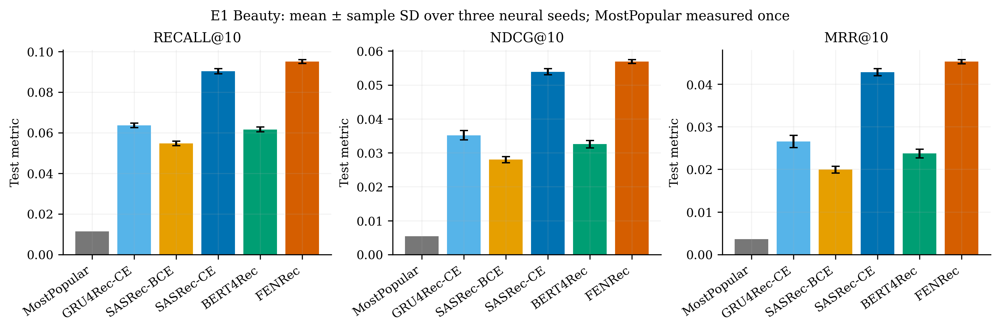
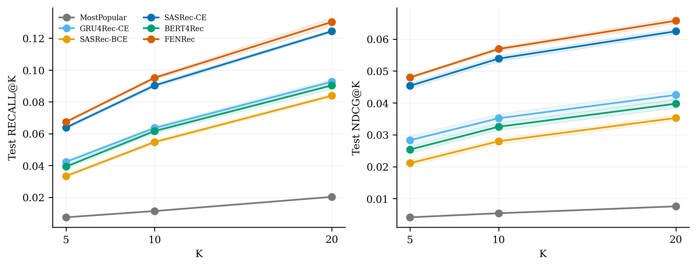
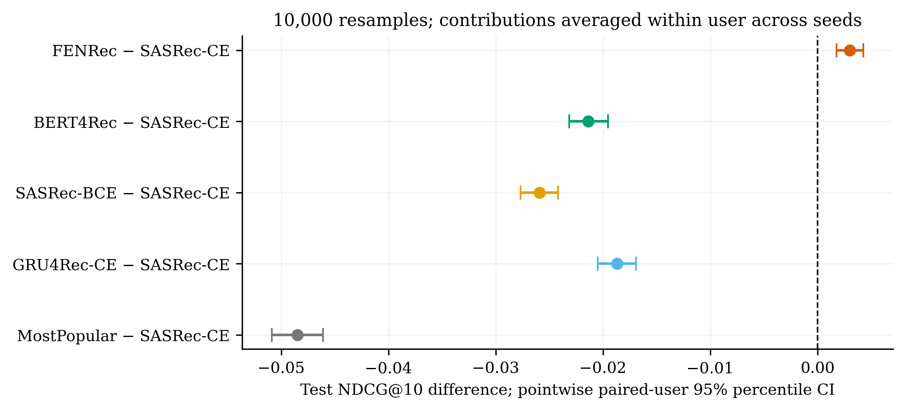
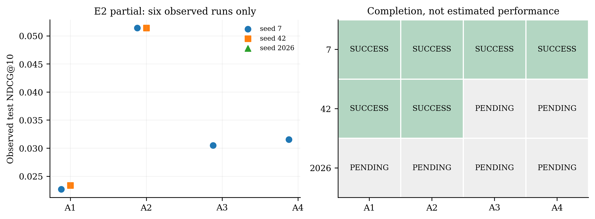
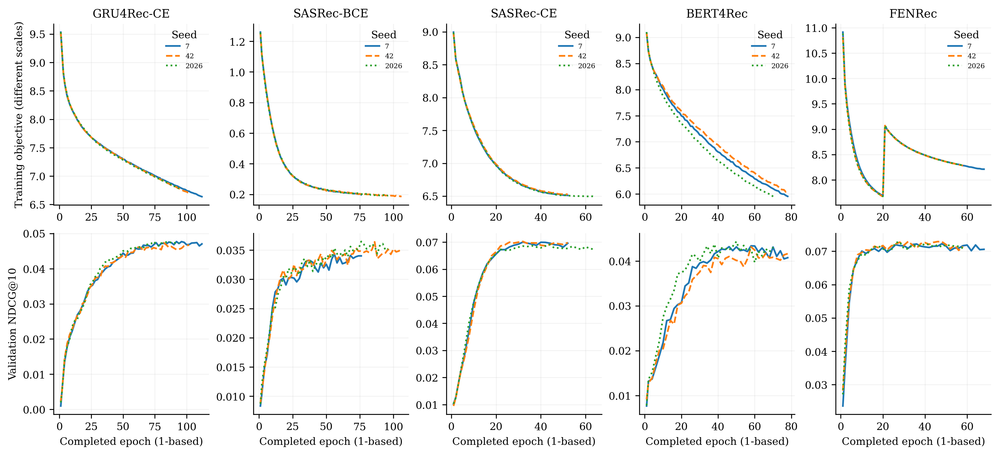
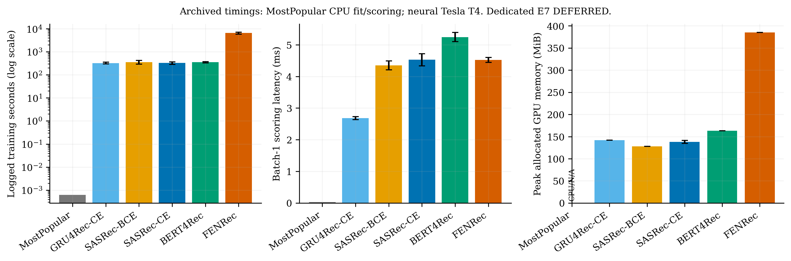
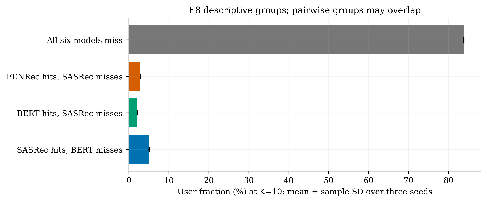
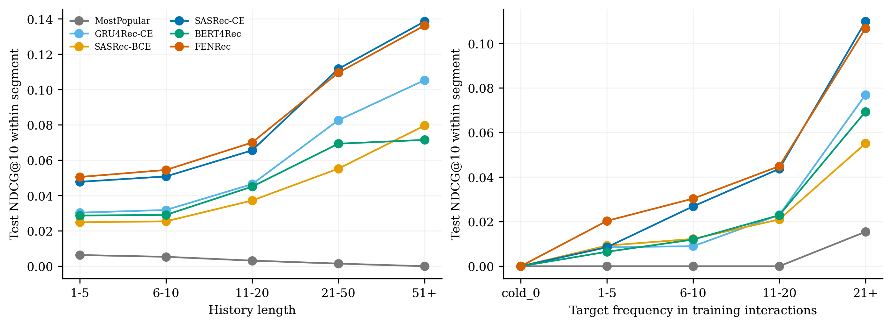

# Phiên thực nghiệm chính thức 1 — E1 hoàn thành, E2 từng phần

Ngày phân tích: **27/11/2026**. Nguồn duy nhất của các số liệu thực nghiệm trong báo cáo này: `seqrec-master-results-20261126_234725_576013.zip`. Không trộn pilot hoặc validation tuning Phase 5C vào bảng test chính thức. Không huấn luyện, tuning, chạy lại inference hay đo GPU trên máy cá nhân.

## 1. Nguồn, tính toàn vẹn và trạng thái

SHA256 ZIP: `9f6b30dd3d29750b21ef64ddd7c8fea88c66d1c3ca52ea44a9809b3cc323cfab`. ZIP gốc được sao chép nguyên byte vào `artifacts/master_session1/`; bản Downloads bên ngoài vẫn giữ nguyên. Raw extraction theo content hash nằm trong `results/raw/master_session1/<sha>/`, preflight toàn bộ xung đột trước khi ghi và không ghi đè artifacts khác hash.

Đã xác minh CRC và SHA256 của **279 tệp**, **240 artifacts có hash trong status**, **43 checkpoint** (22 best, 21 latest; MostPopular là NPZ an toàn) và **22 run SUCCESS**. Hash của toàn bộ 127 cấu hình trong kế hoạch khớp `jobs.json`/progress; 22 cấu hình hoàn thành khớp checkpoint và đường dẫn. Checkpoint load/shape/finite checks thực hiện trên CPU, không inference. Các latest state giữ optimizer/scaler/RNG và best weights khớp bản best riêng.

Bundle Beauty cục bộ được tái băm và đối chiếu **đúng manifest dataset lưu trong ZIP**, kiểm tra chronology và phân tách event train/validation/test. Split: `2228499f23f01d419863d0f09b3671f098672471887c4fb37b85bae26d42f91e`. Mỗi run có **22.363 test users**, catalogue **12.101 items**, warm targets **22.225**. Đã đối chiếu từng history/target với split thực tế (test history = train + validation), kiểm tra top-K không lặp/không chứa seen items ngoài target exception, target-rank consistency, tính lại toàn bộ Recall/NDCG/MRR full/warm từ ranks. Không dùng dataset khác để tạo số liệu thay thế.

Artifacts chứa master driver và selections đã chốt trên validation; không có full training-source snapshot/commit attestation. Kiểm tra chứng minh tính toàn vẹn/nhất quán của bằng chứng lưu, không chứng thực mọi mã ngoài archive. Không có lựa chọn winner dựa trên test; các E1 run áp dụng cùng hyperparameters đã chốt trước đó cho ba seeds.

| Experiment | Kế hoạch gốc | SUCCESS | Chưa chạy | Trạng thái |
|---|---:|---:|---:|---|
| E1 | 16 | 16 | 0 | COMPLETE |
| E2 | 12 | 6 | 6 | PARTIAL |
| E3 | 27 | 0 | 27 | PENDING |
| E4 | 36 | 0 | 36 | PENDING trong export; nay DEFERRED |
| E5 | 36 | 0 | 36 | PENDING trong export; nay DEFERRED |
| Tổng gốc | 127 | 22 | 105 | BUDGET_STOP |

Phiên được người thực hiện báo cáo dừng chủ động sau khoảng 8,5 giờ. Đây không phải lỗi convergence toàn bộ grid. E7 dedicated GPU measurements vẫn **DEFERRED**. E8 phân tích cục bộ từ predictions đã hoàn thành trong đợt này.

## 2. E1: kết quả test ba seeds

Các neural model có đủ seeds **7, 42, 2026**. MostPopular là baseline xác định, chỉ chạy **một lần**; không nhân bản thành ba observations và không ghi SD bằng 0 giả. SD neural dùng sample SD (`ddof=1`). Mọi người dùng test, bao gồm cold targets, được giữ trong full metrics.

| Mô hình | Số run | Recall@10 mean ± SD | NDCG@10 mean ± SD | MRR@10 mean ± SD |
|---|---|---|---|---|
| MostPopular | 1 | 0.011403 (SD N/A) | 0.005416 (SD N/A) | 0.003579 (SD N/A) |
| GRU4Rec-CE | 3 | 0.063617 ± 0.001153 | 0.035188 ± 0.001375 | 0.026571 ± 0.001440 |
| SASRec-BCE | 3 | 0.054748 ± 0.001147 | 0.027987 ± 0.000894 | 0.019934 ± 0.000805 |
| SASRec-CE | 3 | 0.090283 ± 0.001252 | 0.053890 ± 0.000909 | 0.042804 ± 0.000823 |
| BERT4Rec | 3 | 0.061620 ± 0.001203 | 0.032532 ± 0.001083 | 0.023736 ± 0.001024 |
| FENRec | 3 | 0.095112 ± 0.000942 | 0.056907 ± 0.000596 | 0.045271 ± 0.000511 |

Bảng đầy đủ gồm Recall@5/10/20, NDCG@5/10/20, MRR@10 cho cả **full** và **warm** trong `results/tables/master_session1/metric_summary.csv`; từng seed nằm trong `per_seed_metrics.csv`. Các kết quả là test chính thức sau validation-based stopping, không phải validation tuning scores.

### Paired bootstrap

Ghép đúng user ID, target và split; với neural model lấy trung bình contribution của mỗi user qua ba seeds trước khi bootstrap. MostPopular được dùng như một predictor cố định. Lấy mẫu lại **người dùng** 10.000 lần với replacement, seed bootstrap 42; báo cáo percentile 95% CI của hiệu left-minus-right, cho cả 15 cặp mô hình và 7 metrics. Không coi user×seed là 67.089 người dùng độc lập.

Implementation gom các vector contribution-difference trùng nhau và lấy multiplicities từ multinomial theo tần suất thực nghiệm. Đây là **cùng phân phối exact empirical row bootstrap**, không phải xấp xỉ normal; các metrics dùng cùng multiplicities trong mỗi replicate. Chỉ giảm chi phí tính toán phân tích, không thay đổi evaluation protocol.

FENRec − SASRec-CE có chênh lệch test NDCG@10 **0.003017**, CI **[0.001773, 0.004285]**. Khoảng điều kiện này nằm phía dương ở các checkpoint đã lưu; **không** bao trùm đầy đủ bất định do retraining/seed selection. Các CI là pointwise, chưa điều chỉnh 15 cặp/đa metrics, không cung cấp confirmatory p-value hoặc khẳng định tổng quát vượt ngoài Beauty và thiết kế đã chạy. Không dùng kết quả này để quyết định phạm vi còn lại.





## 3. E2: thiết kế chưa hoàn tất

| Variant | Seed 7 NDCG@10 | Seed 42 NDCG@10 | Seed 2026 NDCG@10 | Coverage |
|---|---|---|---|---|
| A1 | 0.022664 | 0.023347 | PENDING | 2/3 |
| A2 | 0.051402 | 0.051426 | PENDING | 2/3 |
| A3 | 0.030485 | PENDING | PENDING | 1/3 |
| A4 | 0.031526 | PENDING | PENDING | 1/3 |

A1/A2 mới có hai seeds; A3/A4 chỉ có seed 7. Không gộp những tập seeds khác nhau rồi gọi đó là kết quả ba-seed đầy đủ. Sáu cấu hình còn thiếu: A3/A4 seed 42 và A1–A4 seed 2026. Matched-capacity checks cho thấy parameter counts của các run E2 hiện có bằng nhau; chúng dùng E2 backbone riêng, không dùng E1 SASRec/BERT4Rec như aliases.

So sánh A2−A1 chỉ dùng seeds 7/42 chung; A4−A3 chỉ dùng seed 7. Các CI tương ứng trong bảng bootstrap ghi rõ coverage. Ở dữ liệu hiện có, A2 đạt NDCG@10 cao hơn A1; A4−A3 có interval chứa 0. Đây là phân tích từng phần; chưa kết luận thiết kế E2 hoàn tất hoặc hiệu quả attention/objective tổng quát.

Hai run chạm trần epoch: **E2 A1 seed 7, E2 A4 seed 7**. Các neural E1 dừng theo patience. Từ `converged` trong log được diễn giải là **dừng vận hành theo patience**, không phải chứng minh hội tụ toàn cục. Best epoch, completed epochs và loss đầu/cuối lưu trong `runs.csv`; loss giữa BCE/CE/masked/FENRec có objective khác nhau, không so thang loss tuyệt đối để xếp hạng mô hình.




## 4. Hiệu năng tính toán đã ghi nhận

| Mô hình | Training phút mean ± SD | Batch-1 scoring ms mean ± SD | Peak allocated MiB mean ± SD | Parameters |
|---|---|---|---|---|
| MostPopular | 0.000010 (1 run) | 0.032132 (1 run) | N/A | 0 |
| GRU4Rec-CE | 5.426 ± 0.457 | 2.680 ± 0.046 | 142.044 ± 0.050 | 824512 |
| SASRec-BCE | 5.988 ± 1.101 | 4.348 ± 0.144 | 127.701 ± 0.021 | 820032 |
| SASRec-CE | 5.476 ± 0.682 | 4.525 ± 0.191 | 137.863 ± 3.423 | 820032 |
| BERT4Rec | 5.930 ± 0.356 | 5.242 ± 0.145 | 163.307 ± 0.003 | 894277 |
| FENRec | 108.791 ± 10.742 | 4.517 ± 0.079 | 385.062 ± 0.000 | 877888 |

Nguồn là `efficiency.json` và epoch logs trong ZIP. Neural run ghi Tesla T4; MostPopular chạy CPU và chỉ có fit time. Latency profile có 5 warm-up, 20 repeats, batch 1, **history encoding + full-catalog scoring, không sorting/ranking hay disk I/O**. Không nhầm latency này với end-to-end top-K service latency. SD trong bảng là SD giữa các run/seeds của giá trị mean latency, không phải SD của 20 repeats; P95 của từng run được giữ trong `runs.csv`. Không so CPU MostPopular với neural GPU để kết luận một kiến trúc công bằng hơn về tốc độ.

Tổng component time ghi nhận của 22 run khoảng **8.285 giờ**, gồm training **7.672 giờ**, validation **0.584 giờ**, checkpoint writes **52.55 s**, test evaluation được ghi **51.64 s**. Các trường baseline không đo được để N/A, không điền 0 giả. Clustering FENRec **đã nằm trong training time**, không cộng lần nữa. Component sum không phải elapsed session wall time; không gồm mọi setup/export hoặc inference-profile overhead. Peak là **allocated** memory, không phải tổng VRAM của tiến trình/hệ thống.

Những số đo nhúng trong trainer là dữ liệu hiệu năng có thật, có thể tận dụng cho báo cáo môn học; chúng **không hoàn thành E7 dedicated GPU protocol**. Không benchmark lại trên GPU cá nhân. E7 có thể chạy sau trên Kaggle từ checkpoints đã có, không retrain.



## 5. E8: error analysis cục bộ

Đọc predictions E1 đã xác minh, không gọi model inference. Quy tắc hit = target rank ≤10, ghép cùng user/target giữa mô hình; thống kê riêng từng seed và lấy mean/SD qua seeds. Các nhóm pairwise có thể giao nhau; không cộng chúng thành partition. MostPopular cố định được dùng trong nhóm “all six incorrect”, không coi các bản tham chiếu qua seeds là run mới.

| Nhóm | Tỷ lệ user mean ± SD | Mean history length | Trung bình median target train frequency theo seed |
|---|---|---|---|
| all_six_incorrect | 83.856% ± 0.051% | 7.61 | 10.00 |
| bert_only_vs_sasrec | 2.152% ± 0.109% | 9.25 | 37.50 |
| fenrec_only_vs_sasrec | 2.898% ± 0.067% | 8.23 | 27.00 |
| sasrec_only_vs_bert | 5.019% ± 0.218% | 9.32 | 34.00 |

Khoảng **83.86%** users không được mô hình nào hit@10 trong từng seed. FENRec hit trong khi SASRec-CE miss ở khoảng **2.90%**; điều này là complementary errors, không tự chứng minh một cơ chế nhân quả. Phân đoạn history length và target popularity được định nghĩa trước bằng các bins cố định; popularity chỉ đếm **training interactions**, không fit từ test labels. Có phân đoạn cold target frequency=0, giữ nguyên trong báo cáo.

Nguồn metadata/đếm popularity chính là bundle đã kiểm tra hash. Examples chi tiết (history, target title/category, top-K/ranks) lưu **riêng tư** trong `results/derived/master_session1/<sha>/e8_private_examples.json`, chọn ba user ID nhỏ nhất mỗi nhóm/seed theo quy tắc cố định, không cherry-pick trường hợp chênh lệch test score lớn nhất. GitHub chỉ nhận thống kê tổng hợp, không raw per-user predictions/histories.




## 6. Phạm vi thu gọn và việc còn lại

**Lý do: giới hạn thời gian GPU và yêu cầu đồ án môn học. Không dựa vào test score mô hình.** Giữ nguyên bản kế hoạch gốc 127 jobs và trạng thái trong archive; không sửa PENDING thành SUCCESS. Grid Full/Core lịch sử không bị xóa hoặc tái định nghĩa.

- E1 giữ đủ ba neural seeds; hoàn thành 16/16.
- E2 giữ A1–A4 × ba seeds; cần thêm 6 run.
- E3 chỉ SASRec-CE, BERT4Rec, FENRec; retention 0.4 và 1.0; seed 7. Có 6 artifact requests: 3 retention-1.0 **REUSE_AVAILABLE** từ E1, chưa tạo E3 SUCCESS; chỉ 3 retention-0.4 cần training mới.
- Giữ nguyên config/objective/held-outs và `common_warm_ratios=[0.4,0.7,1.0]` trong jobs đã chốt; việc không chạy retention 0.7 không âm thầm đổi định nghĩa common-warm cohort. Full/warm metrics vẫn giữ toàn bộ test cohort như giao thức.
- E4/E5 **DEFERRED**; TIGER/CRAMER **THEORY_ONLY**, không tuyên bố có kết quả thực nghiệm.
- E7 tận dụng số đo hiện có; dedicated GPU pass **DEFERRED**. E8 local aggregate/error analysis **COMPLETED**.

Scope mới có **34 artifact requests**: 22 archived SUCCESS, 3 reuse available và **9 training jobs còn lại**. CSV `course_manifest.csv` giữ trạng thái bằng chứng riêng; `configs/experiments/course_jobs.json` giữ nguyên resolved configuration hashes từ archive. Không đổi hyperparameters sau khi xem test.

Kịch bản planning “chạy tới max epochs × mean observed rate” của 9 jobs khoảng **5.78 giờ**, chưa gồm setup/export/E7. E2 dùng đúng variant đã đo; retention 0.4 chưa chạy nên dùng full-retention rate như **surrogate chưa đo**, không coi đây là thời gian thực tế, trần bảo đảm hay dự báo convergence. Chi tiết ở `remaining_budget_scenarios.csv`. Early stopping, clustering và phần cứng có thể thay đổi thời lượng thực tế; nên chạy E2 thiếu trước, rồi từng E3 retention 0.4 trong các phiên có giới hạn thời gian.

## 7. Tái lập, artifacts và lệnh cho phiên Kaggle tiếp theo

```text
artifacts/master_session1/                 # ZIP gốc và checkpoint bundles, ignored
results/raw/master_session1/<sha>/         # toàn bộ bytes gốc, ignored
results/derived/master_session1/<sha>/     # bootstrap provenance/private E8/notebooks, ignored
results/tables/master_session1/            # bảng tổng hợp được publication
results/figures/master_session1/           # 8 PNG 300 DPI + 8 PDF vector
checkpoints/master_session1/               # 43 checkpoint gốc, ignored
configs/artifacts/master_session1_checkpoints.json  # Release URLs + SHA256
configs/experiments/course_scope.yaml      # lý do và phạm vi thu gọn
configs/experiments/course_jobs.json       # 34 resolved requests, không bịa SUCCESS
```

Phân tích đầy đủ tại máy cá nhân (cần ZIP gốc riêng tư và đúng bundle):

```bash
python scripts/analyze_master_session1.py
python scripts/gen_fig_master_session1.py
python scripts/write_master_session1_report.py
```

Bốn notebook: `E1_Official_Analysis.ipynb`, `E2_Partial_Analysis.ipynb`, `E7_Recorded_Efficiency.ipynb`, `E8_Error_Analysis.ipynb`. Mặc định notebook dùng aggregate tables đã versioned; bật FULL_AUDIT để đọc lại ZIP/dataset và tính bootstrap từ predictions. Không training/tuning hoặc đo GPU trong notebook. Skill `academic-plotting` được áp dụng cho biểu đồ dữ liệu; source figure script được lưu. Error bars/bands là sample SD thật hoặc CI được chỉ rõ; các cấu hình thiếu không có điểm số giả.

Checkpoint best/resume công khai phân phối riêng qua GitHub Release `master-session1-checkpoints-v1`, không qua Git object history. Gói này chỉ có weights/configs, không chứa raw predictions/dataset/logs/credentials. Sau clone: `python scripts/fetch_master_checkpoints.py`; thêm `--with-resume` để lấy latest states. MostPopular checkpoint là NPZ: dùng `MostPopular.load`, neural dùng `SequentialModel.load(..., device='cpu')`. Gói checkpoint không đủ để xác minh lại per-user metrics nếu không có ZIP gốc.

Để tiếp tục trên Kaggle: attach ZIP gốc riêng tư và bundle, restore đầy đủ artifacts vào repository rồi chạy driver scope mới. Không lấy checkpoint-only Release thay cho toàn bộ run tree khi resume workflow.

```bash
# Kaggle ONLY: replace actual input paths; does not change existing original artifacts.
python scripts/kaggle_session.py restore --archive /kaggle/input/PRIVATE_EXPORT/seqrec-master-results-20261126_234725_576013.zip --destination /kaggle/working/sequential-recommendation
python scripts/run_course_remaining.py --experiment E2
python scripts/run_course_remaining.py --experiment E2 --archive-job-id 22 --bundle data/processed/beauty/HASH --device cuda:0 --run
# Repeat for original E2 job IDs 23,24,25,26,27.
python scripts/run_course_remaining.py --experiment E3 --archive-job-id 28 --bundle data/processed/beauty/HASH --device cuda:0 --run
# New E3 retention-0.4 IDs: 28,31,34. Reuse-only ratio-1.0 IDs: 30,33,36.
```

Không có `--run` thì chỉ in kế hoạch. Driver từ chối experimental training trên máy cá nhân, từ chối retrain jobs archived SUCCESS nếu chưa restore, và yêu cầu E1 source khi reuse. Sau mỗi phiên Kaggle export ZIP mới; không giả định `/kaggle/working` tồn tại ở phiên sau. E7 GPU-only có thể dùng `run_experiment.py --profile core_research --experiment E7 --bundle ... --device cuda:0 --results-root results/core` trên Kaggle; phân tích E8/thống kê/biểu đồ/publication tiếp tục làm tại máy cá nhân.
