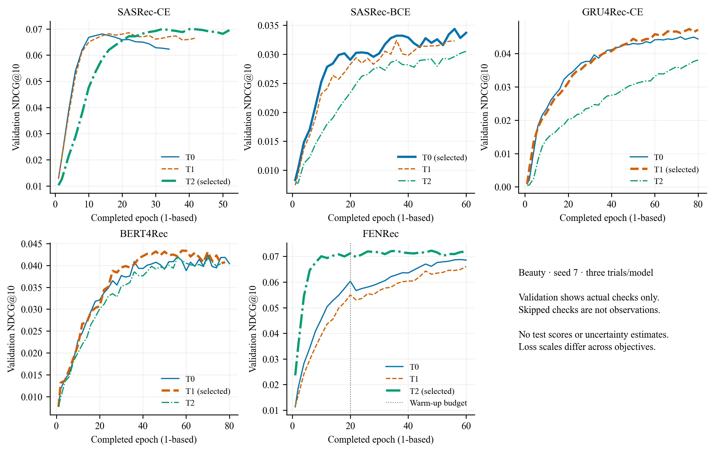
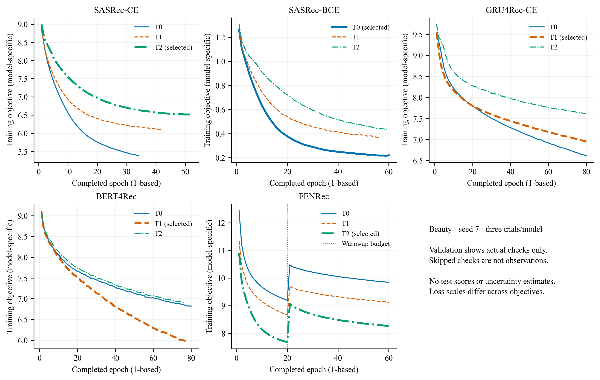
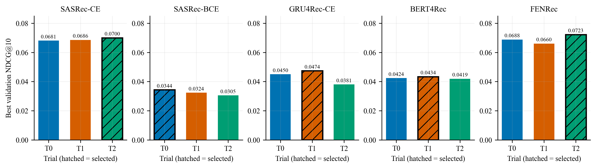
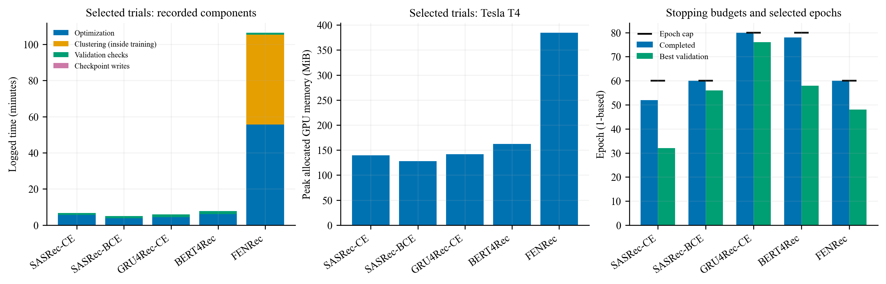

# Phase 5C — Báo cáo xác minh và phân tích tuning

Ngày phân tích: 26/11/2026. Trạng thái: **hoàn thành 15/15 trial của đợt tuning giới hạn đã xuất từ Kaggle**. Đây không phải kết quả final test hay toàn bộ không gian tìm kiếm hyperparameters. Không chạy lại tuning hoặc huấn luyện trên máy cá nhân trong quá trình phân tích.

## Nguồn duy nhất và phạm vi xác minh

Nguồn thực nghiệm duy nhất: `seqrec-phase5c-final-20261126_132556_321898.zip`.

SHA256: `7861c626561fc1d7914abb8ee5a7eb4d552a932aca5dfbc54419648efb0176fa`.

Archive có 182 tệp, tổng dung lượng giải nén 277,747,136 byte. Đã kiểm tra CRC toàn bộ ZIP, hash từng tệp, 150 artifacts có hash trong status, 30 checkpoint best/latest, hash của 5 tuning plan và 15 configuration. Tất cả 15 run đều `VALIDATED`, seed 7, Beauty, không phải pilot, không giới hạn batch hoặc người dùng validation. Kiểm tra CPU chỉ đọc checkpoint, cấu trúc trọng số và trạng thái resume; không forward, backward hoặc optimizer step trên dữ liệu thực nghiệm.

Mỗi trial chứa đầy đủ predictions cho **22.363 người dùng validation**, trên catalogue **12.101 items**. Đã tính lại Recall/NDCG/MRR từ target ranks, kiểm tra top-K, loại lịch sử đã thấy, ngoại lệ target, coverage full/warm và sự đồng nhất user/history/target giữa cả 15 trial. Không chấm lại điểm mô hình hoặc chạy evaluation GPU tại máy cá nhân.

Split chung: `2228499f23f01d419863d0f09b3671f098672471887c4fb37b85bae26d42f91e`. Báo cáo kiểm tra dữ liệu trong ZIP ghi `PASSED`, gồm chronology, event/target separation và training-only FENRec windows; các plan, config và checkpoint khớp split này. **ZIP không chứa dataset gốc hoặc manifest đầy đủ của bundle, nên phân tích này không thể tái băm độc lập các byte dataset hay tự chứng minh lại chronology từ dữ liệu thô.** Không dùng dataset hoặc kết quả cục bộ khác làm nguồn số liệu Phase 5C.

ZIP cũng không có source snapshot hoặc Git commit attestation của phiên training. Do đó xác minh chứng minh tính nhất quán của artifacts cung cấp, không chứng thực toàn bộ mã đã chạy ngoài những bằng chứng được lưu.

## Lựa chọn chỉ dùng validation

`evaluate_test=false` trong cả 5 plan, 15 config và efficiency record. Không có `test_metrics.json` hoặc raw test predictions. Cả 5 winner trùng argmax **validation NDCG@10** của 3 trial; khi hòa điểm, quy tắc chọn trial có chỉ số nhỏ hơn được giữ nguyên. Tính lại argmax từ `validation_metrics.csv`, đối chiếu predictions của best checkpoint, `trial_results.json` và `selected_config.yaml`. Không dùng test performance để chọn hoặc sắp xếp cấu hình.

Chỉ số trial T0–T2 giữ nguyên hệ đánh số 0-based của tuner; epoch trong báo cáo và biểu đồ đổi sang **1-based**, còn cột `epoch` gốc trong bảng lịch sử giữ nguyên 0-based. Các đường validation chỉ chứa lần đánh giá thực sự; các giá trị carry-forward ở epoch bỏ qua không được coi là phép đo mới.

| Mô hình | Trial | LR | Batch | Dropout | Tham số riêng | Best val NDCG@10 | Best epoch | Đã chạy/trần | Dừng |
|---|---|---|---|---|---|---|---|---|---|
| SASRec-CE | T2 | 0.0005 | 64 | 0.5 | — | 0.07001077 | 32 | 52/60 | Patience |
| SASRec-BCE | T0 | 0.001 | 128 | 0.2 | — | 0.03436137 | 56 | 60/60 | Trần epochs |
| GRU4Rec-CE | T1 | 0.002 | 128 | 0.5 | — | 0.04738689 | 76 | 80/80 | Trần epochs |
| BERT4Rec | T1 | 0.002 | 128 | 0.2 | mask_ratio=0.15 | 0.04337866 | 58 | 78/80 | Patience |
| FENRec | T2 | 0.002 | 128 | 0.2 | gamma=0.2; lambda_0=0.3; beta_0=0.05 | 0.07225373 | 48 | 60/60 | Trần epochs |

FENRec đạt validation NDCG@10 cao nhất trong các cấu hình được thử (0.07225373), tiếp theo SASRec-CE (0.07001077). Chênh lệch mô tả là 0.00224297 theo thang NDCG, **không phải bằng chứng về final-test superiority hay ý nghĩa thống kê**. Chỉ có một seed, ba trial/mô hình; các tham số thay đổi đồng thời nên không thể quy kết nguyên nhân cho riêng LR, batch hoặc dropout. Không tính error bar, khoảng tin cậy hoặc sample SD từ ba trial có hyperparameters khác nhau.

## Loss, stopping và giới hạn convergence

| Mô hình được chọn | Loss đầu | Loss cuối | Val cuối | Training phút | Peak allocated MiB |
|---|---|---|---|---|---|
| SASRec-CE | 8.99597 | 6.51197 | 0.06958352 | 5.59 | 139.84 |
| SASRec-BCE | 1.25952 | 0.21951 | 0.03369961 | 3.86 | 127.72 |
| GRU4Rec-CE | 9.53276 | 6.94153 | 0.04715606 | 4.35 | 141.92 |
| BERT4Rec | 9.08688 | 5.95443 | 0.04073789 | 6.09 | 162.09 |
| FENRec | 10.91121 | 8.26879 | 0.07187441 | 105.27 | 384.69 |

Loss giảm từ đầu đến cuối ở cả năm trial được chọn. Tuy nhiên BCE, shifted full-softmax CE, masked-item CE và tổng objective FENRec có thang đo/đơn vị khác nhau; **không dùng loss tuyệt đối để xếp hạng giữa mô hình**. FENRec còn có lịch warm-up và trọng số contrastive thay đổi theo epoch, nên bước thay đổi loss không tự chứng minh mất ổn định hoặc overfitting.

Có **6 trial dừng theo patience** và **9 trial chạm trần epochs**. Đã mô phỏng lại counter patience từ các validation checks, có minimum-epoch/warm-up gate, và đối chiếu với latest checkpoint. Patience là tiêu chí dừng vận hành, không chứng minh hội tụ toàn cục.

Các trial chạm trần: BERT4Rec T0, FENRec T0, FENRec T1, FENRec T2, GRU4Rec-CE T0, GRU4Rec-CE T1, GRU4Rec-CE T2, SASRec-BCE T0, SASRec-BCE T2. Cả ba FENRec và cả ba GRU4Rec-CE đều hết ngân sách; không được ghi là đã hội tụ. FENRec giữ nguyên warm-up 20 epochs, chạy tổng 60 epochs. Các trial SASRec-CE dừng ở 34/42/52 epochs; BERT4Rec T1/T2 dừng ở 78/76, SASRec-BCE T1 dừng ở 56. Best checkpoint có thể sớm hơn epoch cuối; phase tiếp theo phải giữ lựa chọn checkpoint theo validation, không tự thay bằng latest weights.

## Chi phí quan sát trên Kaggle

Tổng thời gian epoch training được ghi: **7.270 giờ**; validation checks: **0.328 giờ**; checkpoint writes: **28.45 giây**. Tổng các thành phần này khoảng **7.606 giờ**. Đây là tổng thời gian thành phần ghi nhận, không phải thời lượng session hoặc chi phí GPU billing; không bao gồm chuẩn bị dữ liệu, toàn bộ overhead hoặc final validation pass của selected checkpoint.

FENRec chiếm khoảng 86.0% tổng training time của 15 trial. Clustering FENRec chiếm 40.6% training time của chính FENRec và **đã nằm trong** training time, không cộng hai lần. Phép đo là peak **allocated** GPU memory, không phải tổng VRAM mà hệ điều hành/các tiến trình chiếm. Các run ghi Tesla T4, `cuda:0`; báo cáo môi trường phát hiện hai T4 nhưng artifacts không chứng minh distributed/multi-GPU training.









Mỗi hình có PNG 300 DPI và PDF vector cùng tên trong `results/figures/phase5c/`. Màu và kiểu nét phân biệt trial; không có dải sai số giả. Workflow dữ liệu của skill `academic-plotting` được áp dụng; script tạo hình được lưu trong `scripts/gen_fig_phase5c.py`.

## Tổ chức và tái lập tại máy cá nhân

```text
results/raw/phase5c/<archive-sha>/results/...   # nguyên byte, ignored
results/derived/phase5c/<archive-sha>/         # provenance cục bộ, ignored
results/tables/phase5c/                       # CSV/JSON tổng hợp để publication
results/figures/phase5c/                      # PNG 300 DPI + PDF vector
configs/selected/phase5c/beauty/               # 5 selection YAML nguyên byte + manifest
notebooks/Phase5C_Analysis.ipynb                # audit → tables → plots, không training
```

ZIP gốc được sao chép vào `artifacts/phase5c/` trong repository; bản bên ngoài vẫn giữ nguyên. CLI và notebook mặc định dùng đường dẫn tương đối này, không giả định thư mục Downloads của người dùng khác. Giải nén không ghi đè: tệp đã có phải có hash giống hệt, khác biệt sẽ báo lỗi trước khi ghi thêm bất kỳ tệp nào. Selected YAML sao chép nguyên byte từ archive; `run_path` vẫn là provenance đường dẫn gốc của Kaggle. Checkpoint được tổ chức riêng dưới `checkpoints/phase5c/beauty/<model>/trials/<trial>/`; đường dẫn portable của từng winner nằm trong `configs/artifacts/phase5c_checkpoints.json`.

Tái lập đầy đủ, chỉ tại máy cá nhân:

```powershell
python scripts/analyze_phase5c.py
```

Lệnh trên dùng `artifacts/phase5c/seqrec-phase5c-final-20261126_132556_321898.zip`. Có thể override `--archive PATH` hoặc `SEQREC_PHASE5C_ARCHIVE`; notebook dùng cùng resolver. Chỉ dựng lại hình từ bảng đã xuất:

```bash
python scripts/gen_fig_phase5c.py
python scripts/write_phase5c_report.py
```

Git history chứa inventory/hash, bảng tổng hợp, cấu hình và mã; không chứa binary lớn. Theo yêu cầu cung cấp checkpoint, GitHub Release `phase5c-checkpoints-v1` phân phối riêng các checkpoint nguyên byte cùng cấu hình, không có raw predictions, per-user histories, dataset, logs hoặc credentials. Chạy `python scripts/fetch_phase5c_checkpoints.py` để lấy năm best checkpoint đã chọn; thêm `--all-trials` để lấy đủ 30 best/latest checkpoint. Downloader xác minh SHA256 của ZIP và từng tệp rồi đặt vào cây repository. Gói checkpoint không thay thế ZIP gốc riêng tư để audit toàn bộ predictions. `artifact_audit.json` mô tả phạm vi xác minh; `archive_inventory.csv` ghi tên, kích thước và SHA256 của cả 182 tệp.

## Công việc tiếp theo, chưa thực hiện

Đợt tuning Phase 5C này hoàn thành theo ngân sách 3 trial/mô hình đã xuất. E1 final với seeds 7/42/2026, E2–E5 ablations/robustness, E7/E8 từ final checkpoints, TIGER/E6 và báo cáo thống kê final test **chưa được thực hiện bởi đợt này**. Trial hết ngân sách là hạn chế cần trình bày; không tự tăng epoch hoặc mở lại tuning trong phân tích hiện tại.

Cấu hình có thể dùng qua `--selection configs/selected/phase5c/beauty/MODEL.yaml`; final runs phải tạo hash mới, bật giao thức test cuối cùng và giữ seed/selection provenance. Không resume trial validation-only thành run final khác cấu hình. Ví dụ lệnh chuẩn bị cho Kaggle (không chạy ở máy cá nhân):

```bash
python scripts/run_experiment.py --profile core_research --final-seeds --experiment E1 --dataset beauty --model sasrec_ce --seed 7 --bundle data/processed/beauty/HASH --device cuda:0 --selection configs/selected/phase5c/beauty/sasrec_ce.yaml --results-root results/core --resume
```

Kaggle chỉ dùng cho training/testing/evaluation/đo GPU; phân tích, trực quan hóa, tổng hợp và publication thực hiện tại máy cá nhân. Không suy diễn trạng thái Phase 5B từ ZIP này. Final test chưa có thì không công bố bảng xếp hạng final, p-value hoặc khẳng định cải thiện generalization.
